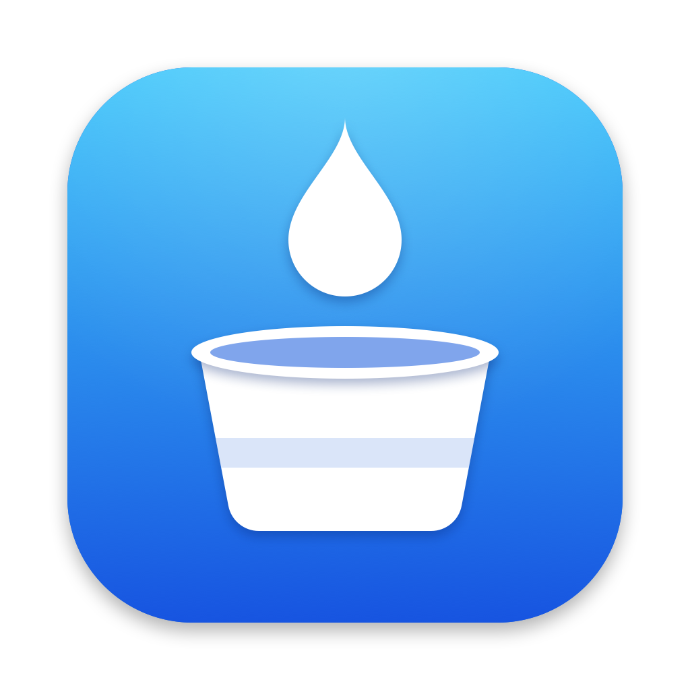

<p align="center"></p>

# DropS3

Native macOS app that backs up folders to an S3 bucket. Built for [Garage](https://garagehq.deuxfleurs.fr/) and compatible with any S3 server that supports path-style addressing. The interface is available in English and Spanish.

- Choose which folders to back up and which paths or patterns to ignore (`node_modules`, `vendor`, `*.log`…).
- Every file is verified after upload; errors are shown per file and with a notification.
- Scheduled backups (hourly, every 6 h, 12 h, daily or weekly) and configurable retention.
- Optional passphrase encryption (AES-256-GCM).
- Restore any backup to a folder of your choice, verified with SHA-256.
- Export and import settings.

## Requirements

- macOS 14 or later (Apple Silicon or Intel).
- An S3 server with a bucket and a key pair with read and write access.

With Garage, for example:

```bash
garage bucket create my-backups
garage key create drops3
garage bucket allow --read --write my-backups --key drops3
```

## Installation

### From a release

1. Download `DropS3-<version>.dmg` from the *Releases* page.
2. Open it and drag **DropS3** to **Applications**.
3. The app is not signed with an Apple developer account, so macOS blocks it the first time. Open it once, go to **System Settings → Privacy & Security** and click **Open Anyway**. Alternatively:

```bash
xattr -dr com.apple.quarantine /Applications/DropS3.app
```

### From source

Only the Command Line Tools are needed (`xcode-select --install`); Xcode is not required.

```bash
./build.sh
open dist/DropS3.app
```

## Usage

### 1. Destination

In **Destination**, enter your server details and click **Test connection**.

| Field | Example | Notes |
|---|---|---|
| Endpoint | `http://10.0.0.5:3900` | `http` or `https`, with port |
| Region | `garage` | Must match Garage's `s3_region` |
| Bucket | `my-backups` | Must already exist |
| Prefix | `backups/my-mac` | Folder inside the bucket; use a different one per machine |
| Access Key ID / Secret Access Key | | The secret key is stored in the Keychain |

The first time, macOS asks for permission to access the **local network**; allow it if the server is on your network.

### 2. Folders and exclusions

- **Folders**: add the folders to back up.
- **Exclusions**: anything that matches is skipped in every folder.

| Pattern | What it skips |
|---|---|
| `node_modules` | Any file or folder with that name |
| `*.log` | Wildcard match on the name |
| `src/tmp` | Path relative to the backed-up folder |
| `/Users/me/Movies` | Absolute path and everything below it |

### 3. Schedule and retention

In **Schedule**, choose the frequency and how many backups to keep. Old backups are only deleted after a backup that finished without errors.

Scheduled backups run while DropS3 is open; it stays active in the menu bar when you close the window. Turn on **Open at login** to have it start automatically.

### 4. Back up

**Overview → Back up now**, or wait for the schedule. When it finishes you'll see the status; **History** keeps the details of every backup and the per-file errors.

### Encryption (optional)

In **Destination → Encryption**, turn on **Encrypt backups** and enter a passphrase.

- File contents and the manifest are encrypted. File and folder names remain visible in the bucket.
- The passphrase is stored in the Keychain. **If you lose it, encrypted backups cannot be recovered**: keep it in a password manager as well.
- During a backup each file is first encrypted to a temporary file, so you need free disk space equivalent to your largest files.

### Restore

1. Go to **Restore** and pick a backup (encrypted ones show a lock).
2. Click **Restore to…** and select the destination folder.

Files end up in `<chosen folder>/<backed-up folder name>/…`, with their permissions and modification date. Each file is checked against the SHA-256 in the manifest before it is put in place, and existing files with the same name are replaced.

Limitations: symbolic links and the permissions and dates of folders are not backed up, and a backup that didn't finish (no manifest) can't be restored.

### Restoring on another machine

Nothing needed for a restore lives on the original Mac, except the keys:

1. Install DropS3 on the new machine.
2. **Settings → Import settings…** (or enter the **Destination** details by hand, with the same prefix).
3. Enter the Secret Access Key and, if applicable, the encryption passphrase.
4. Restore from **Restore**.

If the new machine will make its own backups, use a different prefix: with the same one, retention counts the backups of both machines together.

### Export and import settings

In the **Settings** menu (bottom of the sidebar) or in the File menu. The file includes folders, exclusions, destination and schedule; it does **not** include the Secret Access Key or the encryption passphrase.

### Language

Follows the system language (English or Spanish). You can force one in **Settings → Language**.

## Command line

The binary accepts options that use the saved settings without opening the interface:

```bash
DropS3=/Applications/DropS3.app/Contents/MacOS/DropS3

$DropS3 --test-connection             # checks the destination (read-only)
$DropS3 --backup-now                  # runs a backup
$DropS3 --restore latest ~/Restored   # restores the most recent complete backup
$DropS3 --restore 2026-11-10T19-30-00Z ~/Restored
```

They exit with code 0 on success.

## How backups are stored

Every run creates a full backup (not incremental):

```
<prefix>/
  2026-11-10T19-30-00Z/
    manifest.json            # file list with size, SHA-256, permissions and date
    Documents/report.pdf
    Projects/app/main.swift
```

With encryption on, every object gets an `.enc` suffix (`manifest.json.enc`, `report.pdf.enc`…). Unencrypted backups can be downloaded with any S3 client; encrypted ones can only be decrypted with DropS3. The format is documented in [`Sources/DropS3/Crypto.swift`](Sources/DropS3/Crypto.swift).

Local settings live in `~/Library/Application Support/DropS3/`.

## Development

```bash
./build.sh                          # dist/DropS3.app for this Mac
UNIVERSAL=1 ./build.sh              # Apple Silicon + Intel
VERSION=1.2.0 ./make-dmg.sh         # dist/DropS3-1.2.0.dmg
swift Assets/make-icon.swift icon.png   # redraws the icon artwork
```

| File | Contents |
|---|---|
| `Sources/DropS3/S3Client.swift` | S3 client (SigV4 signing) |
| `Sources/DropS3/BackupEngine.swift` | Backup, verification and retention |
| `Sources/DropS3/RestoreEngine.swift` | Restore |
| `Sources/DropS3/Crypto.swift` | Encryption |
| `Sources/DropS3/Views.swift` | Interface |
| `Sources/DropS3/L10n.swift` | Languages: strings are written as `t("español", "English")` |
